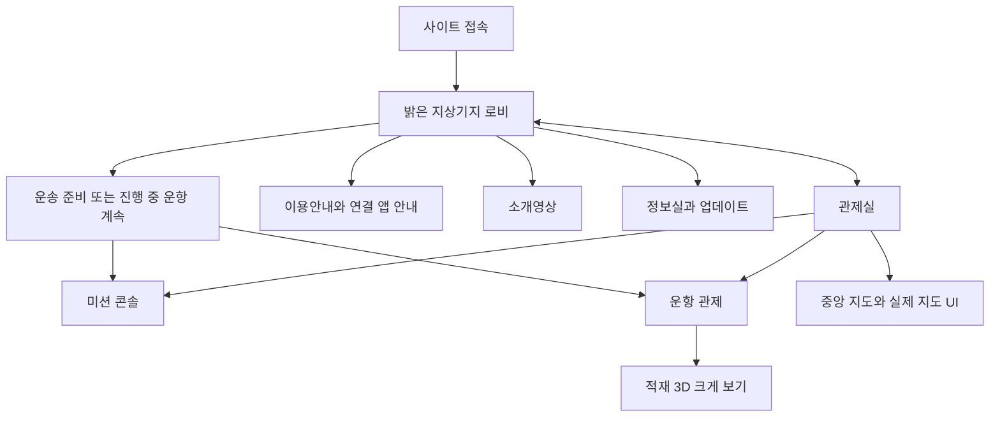

# STAM 라운지와 관제실 및 연결 앱 최종 구성 계획

2026-11-10 KST · Codex · `feature/clear-layout-20261110`

사이트는 밝은 지상기지에서 안내와 정보를 제공하고, 관제실에서 운송 업무를 수행하는 두 공간으로 구성한다. 두 공간은 고화질 이미지 기반 2.5D로 표현하며 콘솔 확대와 실제 기능 화면을 연결한다. Windows 연결 앱은 설치 후 아이콘 하나로 실행하고, 로그 자동 탐색과 선택형 게임 오버레이를 제공하는 방향으로 개편한다.

이 문서가 현재 계획의 기준이다. 사용자가 요청한 공간·앱 요구와 아래의 추천 기본값을 구분한다. 계획과 단계별 구현 상태를 구분한다. 2026-11-10부터 별도 React 미리보기에 라운지/관제센터 동선과 이미지 확대 전환을 구현했다. 실제 업무 데이터 이전·최종 미술 품질·설치 프로그램·오버레이는 아직 완료되지 않았다.

## 1. 확정 방향과 폐기 범위

**2026-11-10 최신 결정:** 밝은 지상 공간은 **STAM 라운지**다. STAM 본부라는 이름은 나중에 여러 사이트를 합칠 때를 위해 남겨둔다. 왼쪽 안내 데스크에는 기존 튜토리얼 파트너, 오른쪽에는 정보실과 영상관을 배치한다. 가운데는 우주 관제센터 연결 터미널과 그 옆 우주선 탑승 게이트다. 실제 탑승/우주 이동은 공간 연결 연출이며 기능 구현 상태가 아니다. 수정 전경 시안은 `/workspace/generated_images/exec-c8cb616a-a677-45f0-be20-8d3602e546ea.png`이고 사용자 확인 전이다. 이미지 속 인물은 기존 파트너를 참고해 생성한 배치 시안이므로 실제 서비스에서 기존 파트너 자산으로 연결해야 한다.

관제실 양쪽 빈 좌석의 모니터는 멀리서 각각 미션/운항 화면이 켜진 느낌을 주고, 클릭·접근 후 해당 실제 UI를 연결한다. 미리 보이는 내용은 시각 시안이며 실시간 동기화 여부는 구현·검증 전 확정하지 않는다. 지도는 실사풍 행성과 우주 배경, 선명하고 충분히 굵은 홀로그램 경로, 출발·경유·목적지 사인과 정거장 아이콘을 사용자 예시처럼 새로 디자인한다. 위치·종류·선택/방문 상태를 크기·형태·라벨로 구분하고 충돌/좁은 화면 표시를 검증한다. 기존 실제 항성계 좌표와 직선 퀀텀 경로/천체 회피·계산 로직을 보존한다. 표현을 변경 가능하게 분리하고 극실사 품질은 실제 브라우저에서 확인한다.

| 구분 | 현재 결정 |
|---|---|
| 관제실 | 사용자가 선택한 어두운 우주 전망대 A를 기준으로 전경과 콘솔 근접 화면 제작. 양쪽에 빈자리 한 곳씩, 원본 STAM 로고·A 글라스 UI 유지 |
| 지상기지 | 밝은 분위기의 별도 공간 추가. 이용안내·소개영상·정보실을 배치하고 관제실과 왕복 |
| 공간 표현 | 고화질 이미지, 필요 부분의 레이어와 제한적인 움직임, 정해진 확대·전환 |
| 지도 | 중앙 홀로그램 클릭 → 확대 → 실제 조작 가능한 항로 지도와 가장자리 UI. 별도 지도 콘솔/모니터 없음 |
| 지도·적재 3D | 실제 회전·확대와 데이터 연결 유지. 공간 배경의 표현 방식과 구분 |
| 연결 앱 | 폴더를 열어 실행 파일을 찾는 경험 개선. 설치·실행·로그 연결을 간소화 |
| 추가 검증 기능 | 로그 자동 탐색, 게임 위 운항 오버레이, 앱 성능 최적화 |

**폐기:** 관제실/지상기지 전체 3D 모델링, 자유 보행·WASD 탐색, 지도 뒤편 콘솔과 모니터, 지도 뒤 180° 회전, 이를 위한 후면 가드·좌석 동선, Blender/Unreal 설치·GPU 렌더 환경 준비, BlenderKit 구독·함교/인물 3D 자산 구매를 선행하는 계획. 미리 렌더링한 3D 카메라 이동 영상 제작도 현 계획에 포함하지 않는다.

기존 미승인 3D 코드·모델·제작 원본은 이번 문서 정리에서 삭제하지 않는다. 새 제품의 메뉴/초기 로딩에서 제외하는 구현 작업을 후속에 수행하며, 이 자료를 확장하는 작업은 재개하지 않는다. 과거 작업 기록은 이 계획보다 우선하지 않는다.

## 2. 메인 화면과 공간 이동

**2026-11-10 사용자 선택:** 밝은 공간 전경은 시안 A를 사용한다. 저장소 사본: `apps/control-room/src/assets/ground-lobby-reference.png`; 생성 원본: `/workspace/generated_images/exec-5f3e6c5d-d40e-4e81-bbe9-4d2767b5a411.png`. 왼쪽 안내 데스크, 중앙 관제 공간 방향, 오른쪽 정보 전시와 영상실 구도가 기준이다. 실제 화면 연결과 로고/파트너 배치는 아직 하지 않았다. 공간 이름은 STAM 라운지로 확정했다.

추천 기본값은 **첫 방문 메인 = 지상기지 로비**다. 햇빛이 들어오는 넓은 유리 공간, 밝은 금속·따뜻한 중성색, 창밖의 지상 시설과 녹지를 시각 방향으로 잡는다. 관제실은 우주 조망과 청백색 홀로그램이 중심인 업무 공간으로 구분하되 로고·글꼴·UI 조작법은 통일한다.

- 로비의 주 행동은 새 사용자에게 `운송 준비하기`, 운항이 진행 중이면 `운항 계속하기`로 제안한다. 실제 상태 연결 후 표시한다. 업무를 시작하기 위해 공간 연출을 여러 번 거치게 하지 않는다.
- 재방문은 마지막 작업 화면 복원 또는 운항 바로가기를 제공한다. 직접 링크는 로비를 강제로 거치지 않고 해당 화면으로 진입한다.
- 라운지와 관제센터는 짧은 화면 전환과 바로가기를 제공한다. 최신 사용자 결정으로 Gemini에서 가로 16:9 이동 영상을 별도 제작 중이다. 첫 클립은 원래 탑승 게이트 앞으로 접근하는 10초 단일 장면으로 제한한다. 검토·확정한 영상만 나중에 연결하며, 건너뛰기와 즉시 이동을 유지한다.
- 소개영상은 영상관에서 명시적으로 재생한다. 방문 때마다 자동 재생하지 않는다. 기존 소개영상의 사이트 스크린샷 제외 방침을 유지한다.
- 파트너 소개를 보여줄 때는 기존 파트너 선택 → 해당 파트너 소개 순서를 보존한다. 로비 안내 때문에 이를 매번 다시 강제하지 않는다.

## 3. 공간별 기능과 버튼 배치

**2026-11-10 사용자 선택:** 어두운 관제센터 A 전경(원본 `/workspace/generated_images/exec-78905289-a630-4218-9321-7392ba6952a0.png`)을 선택했다. 사용자가 좌우에 빈 의자 하나씩을 두고 클릭하면 해당 좌석의 모니터 앞으로 접근하는 방식을 요청했다. 빈자리 이미지 수정 시안은 `apps/control-room/src/assets/control-room-empty-seats-reference.png`이며 사용자 검토 대기다. 가운데 지구 홀로그램은 전경 분위기 시안으로, 실제 조작 지도는 기존 결정대로 스탠턴 항성계다. 실제 좌석 클릭·확대·모니터 UI와 기존 파트너/STAM 로고는 아직 구현되지 않았다.

| 공간/위치 | 기능 |
|---|---|
| 지상기지 안내 데스크 | 시작 방법, 앱 설치/연결, 기본 사용 순서, 문제 해결. 기존 튜토리얼 파트너와 연결 |
| 지상기지 영상관 | 소개영상 재생·닫기. 고화질 영상은 열 때 로드 |
| 지상기지 정보실 | 기존 함선/미션/화물 정보, 자주 묻는 질문, 업데이트 내역으로 이동. 구현되지 않은 거래·커뮤니티 기능을 꾸며 넣지 않음 |
| 지상기지 관제실 입구 | 관제실 전경으로 이동. 운송 바로가기는 같은 업무 화면으로 직접 연결 |
| 관제실 왼쪽 콘솔 | 함선·드라이브·그리드, 출발지, 계약 수신/입력/확인, 경로 계산 |
| 관제실 중앙 지도 | 스탠턴 중심의 항성계/목적지/경로 탐색. 기존 지원 항성계와 정식 좌표 기능 보존 |
| 관제실 오른쪽 콘솔 | 현재 운항, 다음 목적지, 접수/배송 작업, 방문 순서, 완료/되돌리기, 적재 3D |
| 관제실 두 파트너 | 왼쪽 기존 튜토리얼 파트너 고정. 오른쪽 기존 오퍼레이터/항해사 선택·대화·응답·대화 중 변경. 외형 변경은 별도 후속 |

상단은 원본 STAM 로고, `지상기지 / 관제실` 전환, 연결 상태, 계정·언어·설정으로 구성한다. 상태 표시는 실제 연결 상태만 사용한다. 하단은 공간별 바로가기를 제공한다. 기지에서는 안내·영상·정보·관제실, 관제실에서는 전경·미션·지도·운항으로 구성한다. 세부 기능을 상하단에 모두 나열하지 않는다.

기본 화면은 큰 좌우 사이드바 없이 공간을 넓게 사용한다. 기능을 열면 필요한 목록/상세 패널만 표시한다. 적재는 운항 관제와 출항 전 경로 검토에서 같은 뷰를 공유하고, 크게 펼치기를 제공한다. 지도와 적재의 확대 화면은 고정 바를 제외한 작업 영역을 사용한다.

공간 속 선택 지점에는 짧은 이름을 표시하고 실제 링크/버튼으로 구현한다. 마우스 올리기에 의존하지 않는다. 하단 바로가기는 터치·키보드와 연출 생략을 위한 동등한 경로다. 모바일에서는 바로가기를 우선하고, 배경 잘림 때문에 기능이 사라지지 않게 한다.

## 4. 이미지 제작과 접근 연출

### 2026-11-10 공간 반응과 이동 요청

- 라운지 시안의 작은 생성 인물은 얼굴이 선명하지 않다. 기존 `assets/partners/director-portrait.webp`를 기준으로 실제 튜토리얼 파트너를 별도 레이어/근접 화면에 연결한다. 생성된 인물이 실제 자산에 연결됐다고 표시하지 않는다.
- 클릭 대상인 안내 데스크·터미널·게이트·정보실·영상관·빈 좌석·중앙 지도는 대상 형태를 따라 절제된 네온 윤곽/빛과 짧은 이름을 제공하고, 포인터를 올리거나 키보드 포커스를 받으면 피드백한다. 세그먼트는 이미지 표시용 마스크/SVG와 실제 버튼 영역을 분리하며, 클릭 가능 여부를 hover에만 의존하지 않는다.
- 선택 가능한 짧은 효과음은 사전 사용자 상호작용 이후에만 재생한다. 기본 음소거 또는 낮은 소리와 켜기/끄기, 반복 hover 시 중첩 방지를 설계한다. 터치에서는 항상 보이는 이름/버튼과 첫 탭 피드백을 제공하고, 키보드 포커스·움직임 줄이기 옵션을 지원한다.
- 안내 데스크: 클릭 → 데스크 앞으로 접근 → 선명한 기존 파트너와 이용안내. 영상관: 클릭 → 입구에 접근 → 영상관/플레이어로 연결하고 사용자가 재생. 정보실도 접근 후 실제 정보 화면으로 연결한다. 어느 화면에서도 되돌아갈 수 있다.
- 탑승 게이트: 클릭 → 게이트로 확대 → 짧은 연결 전환 → 우주의 관제센터 전경. 처음에는 2.5D 전환으로 구현하고 우주선 이륙 영상을 실제로 확보하기 전에는 재생된다고 약속하지 않는다. 터미널/게이트 구분은 접근성 표시를 포함한다.
- 관제센터 빈 좌석: hover/포커스 시 해당 의자가 뒤로 살짝 나와 앉을 자리를 제시하고, 클릭 → 좌석 시점/모니터 확대 → 왼쪽 미션 또는 오른쪽 운항 UI. 원본 이미지의 의자만 독립 레이어로 분리하고 가려졌던 배경을 별도 복원해 움직임을 제작한다. 선택 결과는 미검증 시안이며 3D 자유 이동은 아니다.
- 이 목록은 사용자 요구와 구현 계획이다. 세그먼트, 사운드, 캐릭터 고해상도 교체, 의자 동작, 접근/복귀 전환은 아직 구현하지 않았다. 첫 구현은 한 개 좌석과 한 개 라운지 대상에서 실제 브라우저로 움직임·입력·오디오·저성능 동작을 검증하고 확장한다.

1. 관제실 전경과 밝은 지상기지 전경을 각각 제작한다. 승인 함교 이미지는 관제실의 시각 기준이며 새 기지 이미지는 별도 검토한다.
2. 좌우 콘솔의 고해상도 근접 이미지를 만든다. 전경과 콘솔 형태·방향·빛·주변 인물이 맞는지 대조한다. 확대만으로 부족한 부분을 단순 업스케일로 해결했다고 간주하지 않는다.
3. 파트너·움직이는 모니터·홀로그램 등 필요한 부분만 분리한다. 기존 캐릭터를 먼저 사용하며 실제 로고/문구/버튼은 웹 요소로 표시한다.
4. 콘솔 클릭 → 주변 명도 조절 → 제한된 확대/이동/원근 보정 → 근접 이미지 → 실제 기능 UI 순서로 연결한다. 한 이미지에서 보이지 않는 옆면을 크게 드러내는 이동은 설계하지 않는다.
5. 지도는 홀로그램 쪽으로 확대하고 실제 지도 화면으로 이어진다. UI는 가장자리에서 나타난다. 배경의 지도 그림과 실제 항성계 좌표는 별개다.
6. 복귀 동작, 빠른 연속 클릭 취소, 브라우저 뒤로가기, 키보드 포커스, 움직임 줄이기를 함께 구현한다. 주요 업무 조작 때마다 연출을 반복하지 않는다.

이미지·선택 영역·전환 설정을 분리해 배경을 바꿔도 계산 로직을 수정하지 않게 한다. 지상기지와 관제실을 동시에 고해상도로 디코딩하거나 모든 영상을 자동 재생하지 않는다. 화면 밖 효과는 멈추고 이미지 크기별 자산/지연 로딩을 적용한다.

실사에 가까운 품질은 원본 이미지와 근접 화면의 일관성으로 검증한다. 제작 방식만으로 목표 달성을 보장하지 않는다. **첫 시제품은 관제실 전경과 콘솔 하나의 실제 접근/복귀**다. 전체 작업을 확대하기 전에 이것을 확인한다.

## 5. 연결 앱 개편과 젠스튜디오 참고

사용자 저장소 [Gen Studio](https://github.com/limmin3-sudo/gen-studio)의 코드를 읽기 전용으로 확인했다.

- [바로가기 생성](https://github.com/limmin3-sudo/gen-studio/blob/main/scripts/make_shortcut.ps1)은 바탕화면/시작 메뉴 아이콘이 내부 `pythonw` 실행기로 앱 모듈을 여는 방식이다.
- [데스크톱 실행 코드](https://github.com/limmin3-sudo/gen-studio/blob/main/genstudio/desktop.py)는 백그라운드 서버, 앱 창, 트레이와 종료를 관리한다. Python 의존성에는 pywebview/pystray가 있고 앱 창은 WebView2 경로를 사용한다.
- 사용자가 경험한 '아이콘 하나'는 내부 파일을 사용자가 직접 관리하지 않는 실행 경험이다. STAM도 이를 기본 목표로 한다. Gen Studio 코드를 수정하거나 모델/서버를 실행하지 않았다.

**추천:** STAM의 실행 화면·설치·트레이·설정 흐름을 새로 구성하고, 검증된 로그 파서와 읽기 전용 로컬 API를 재사용한다. Python/Electron/Tauri로 전체를 재작성하는 것은 선행 조건으로 두지 않는다. 현재 C# 실행기와 Node 처리기를 먼저 평가한다.

| 항목 | 계획 |
|---|---|
| 설치/실행 | 설치 파일 하나 → 사용자별 내부 설치 폴더 관리 → STAM 아이콘으로 실행. Node 별도 설치/ZIP 폴더 관리 제거 목표 |
| 첫 실행 | 자동 로그 탐색 → 결과 확인/필요 시 선택 → 연결 상태 표시. 웹사이트 열기는 명시적 버튼 |
| 평상시 | 로그 연결, 웹사이트 열기, 오버레이 켜기, 설정/진단 중심의 간단한 화면 |
| 트레이 | 열기·연결 상태·오버레이·종료. 닫을 때 백그라운드 유지 여부를 명확하게 안내 |
| 업데이트 | 웹사이트와 연결 앱 버전을 분리. 앱 업데이트 실패 시 이전 실행본으로 복구하고 설정 보존 |
| 무설치 한 파일 EXE | 추가 검토 항목. 런타임 내장/자동 추출, 실행 속도, 갱신과 진단을 비교한 뒤 결정. 기본 설치형 아이콘 경험과 혼동하지 않음 |

사이트의 로그인·게스트 데이터·계약·계산은 기존 공개 origin에 유지한다. Gen Studio처럼 앱 창을 제공하더라도 WebView 저장소가 기존 브라우저의 로그인/저장을 자동 공유한다고 가정하지 않는다. 새 앱 창에 사이트 전체를 넣는 결정은 계정/저장 동작 검증 후 별도로 한다.

### 로그 자동 탐색

- 이전에 확인한 경로 → 설치 위치 정보가 확인될 경우 그 위치 → 제한된 표준 설치 경로 → 사용자 지정 폴더 순서로 탐색한다. 탐색 단계와 중단/수동 선택을 제공하고 전체 디스크를 반복 스캔하지 않는다.
- LIVE/PTU 등 채널과 실제 파일 존재·접근 가능 여부를 표시한다. 후보가 여러 개면 채널을 선택한다. 단순히 가장 최근 파일이라는 이유만으로 다른 채널을 연결하지 않는다.
- 자동 탐색이 성공하면 최초에 경로/채널을 확인하고, 이후에는 저장한 선택으로 재연결한다. 게임 미실행/로그 없음/권한 문제를 서로 다르게 표시한다.
- Game.log 교체·축소·게임 재시작 후 재연결과 중복 계약 방지를 검증한다. 기존 `reader-node.mjs`에는 이미 증분 읽기와 교체/축소 감지가 있으므로 이를 보존한다.
- 게임 파일은 읽기 전용이며 실제 로그가 제공하지 않는 수량·보상·완료 상태를 만들어 넣지 않는다.

### 앱 성능 개선

기준 실행 시간/메모리/유휴 CPU/로그 수신 지연을 먼저 측정한다. 현재 증분 읽기를 유지하고 불필요한 재해석·UI 갱신·백그라운드 재시도를 줄인다. 중복 프로세스와 종료 후 남는 처리기를 방지한다. 앱 자체에는 관제실 배경 영상이나 전체 3D 지도를 상시 렌더링하지 않는다. 측정 전 절감률이나 FPS를 보장하지 않는다.

## 6. 게임 오버레이

연결 앱의 선택형 기능으로 개발한다. 첫 단계는 **작은 읽기 전용 운항 HUD**다. 다음 목적지, 접수/배송 구분, 이번 작업 화물 요약, 연결 상태와 갱신 시각을 표시한다. 전체 관제실/동영상/적재 3D를 HUD에서 계속 실행하지 않는다.

- 표시/숨김 단축키, 위치·크기·투명도, 클릭 통과와 배치 편집 모드를 제공한다. 단축키 충돌을 감지하고 바꿀 수 있게 한다.
- 기본은 게임 입력을 가로채지 않는 비활성 표시다. 표시 위치 편집은 명시적 모드에서 수행한다. 운항 완료/취소 등 상태 변경 버튼은 첫 버전에 넣지 않는다.
- 창 모드/테두리 없는 창에서 외부 최상위 창 방식부터 검증한다. 독점 전체화면 지원은 미확정이다. 게임 프로세스 주입/렌더 후킹을 현 계획에 넣지 않는다.
- Windows DPI·다중 모니터·해상도 변경·Alt+Tab·DirectX/Vulkan·실제 게임/EAC 환경에서 표시와 입력 문제를 확인한다. 최상위 창 구현만으로 호환성이나 RSI 공식 승인이 입증되는 것은 아니다.
- 표시가 불가능한 환경에서는 일반 작은 운항창/두 번째 모니터로 사용할 수 있게 한다.

**데이터 연결을 별도로 구현해야 한다.** 현재 앱은 게임 로그를 웹에 전달할 뿐, 웹의 확정 운항 계획을 갖고 있지 않다. 웹의 확정 상태를 제한된 로컬 전송으로 공유하고 오버레이는 이를 표시하도록 설계한다. 세션/운항 ID·스냅샷 버전·갱신 시각·연결 만료를 검증한다. 기존 GET API/CORS/토큰 규칙을 임의로 풀지 않는다. 다중 탭에서는 게시할 활성 운항을 명확히 하고 계정 전환·로그아웃 시 전송/캐시를 분리한다. 연결이 끊기면 오래된 안내임을 표시한다.

참고: [Microsoft의 창·레이어·입력 설명](https://learn.microsoft.com/en-us/windows/win32/winmsg/window-features), [RSI의 오버레이 충돌 안내](https://support.robertsspaceindustries.com/hc/en-us/articles/360000083167-Unsupported-Applications-Peripherals-and-Overlays). 이는 설계/검증 참고이며 STAM 동작 확인 결과가 아니다.

## 7. 실제 기능과 튜토리얼

React/TypeScript/Vite는 새 화면을 담당하고 기존 JavaScript 계산 엔진을 재사용한다. 화면 이동만으로 미션/운항/적재를 재설정하지 않는다. 세 언어 ko/mix/en, 로그인/게스트 분리, 기존 개인 위치와 함선 설정을 보존한다. 로그/SCMDB/수동 실제값의 역할과 계약별 화물 ID·SCU·적재 방향·상태를 유지한다. RAFT/Golem OX는 위에서 아래로, Hull 계열 부착 프레임은 기존 규칙을 따른다.

지도는 실제 좌표·직선 퀀텀 경로·천체 회피를 재사용하고 굵은 경로/선택 표식을 개선한다. 적재는 밝은 배경·청백색 공간 그리드·금속 컨테이너로 개선한다. 두 뷰 모두 bloom 비활성 및 기능 동등성을 유지한다. 정확한 허가된 함선 외형이 없으면 grid-only를 유지한다.

튜토리얼은 핵심 화면 완성 후 기존 전담 파트너가 실제 사이트 위에서 안내하는 방식으로 만든다. [Bokoko33의 방](https://room.bokoko33.me/)은 사물을 선택하며 알아가는 경험의 참고로 유지한다. 실제 3D 방 복제나 자유 이동은 요구하지 않는다. 예시 상태 분리, 건너뛰기·나가기·재진입을 제공한다. 지상기지 이용안내는 튜토리얼 구현 전에도 읽을 수 있게 한다.

## 8. 실행 순서와 완료 기준

| 단계 | 산출물 | 확인 기준 |
|---|---|---|
| 0 현재 | 최종 구성 저장, 폐기 계획 정리 | 새 AI가 취소된 3D 모델링/회전 동선을 재개하지 않음 |
| 1 화면 검증 | 관제실 전경 + 콘솔 한 곳의 접근/복귀, 지상기지 대표 이미지와 배치 시안 | 원경·근접 품질/일관성, 버튼과 로고, 모바일에서 실제 확인 |
| 2 공간 구성 | 로비·안내·영상·정보·관제실 왕복과 바로가기 | 직접 링크/뒤로가기/키보드/전환 생략, 기능 위치 이해 |
| 3 업무 연결 | 미션 → 지도/경로 → 운항/적재, 파트너 선택/대화 | 기존 기능·저장·세 언어 동등성, 실제 계약 소유권 보존 |
| 4 연결 앱 | 아이콘 실행, 새 연결 화면, 로그 자동 탐색, 트레이/진단, 설치/업데이트 | 실제 Windows 신규 설치·기존 설정 승계·여러 설치 위치/채널·재시작·CPU/메모리 측정 |
| 5 오버레이 | 웹 확정 상태 연결 + 최소 HUD | 실제 게임 표시/입력/DPI/연결 만료/다중 탭, 지원 환경 명시 |
| 6 마무리 | 파트너 튜토리얼·성능·접근성·전체 회귀 | 예시/실제 상태 분리, 낮은 성능과 모바일, 복구 경로 |
| 7 공개 전 검토 | 완성 미리보기, 웹/앱 배포물, 변경·복구 안내 | 사용자 확인 및 배포 지시 후 공개 |

사이트 시각 검증과 앱 기술 검토는 별도 진행할 수 있지만, 초기 우선순위는 화면 품질과 핵심 업무 동선이다. 오버레이는 확정 운항 데이터 연결 뒤에 구현한다. 일정을 근거 없이 고정하지 않고 각 단계의 실제 결과로 범위를 조정한다.

## 9. 준비물과 남은 선택

- 기존 로고·파트너·승인 관제실 이미지·소개영상·이용안내·정보 데이터를 먼저 사용한다. 새 지상기지와 콘솔 근접 이미지, 클릭 영역과 전환 설정을 추가 제작한다. 정확한 공개용 이미지 자산을 확인한 뒤 배포한다.
- 로컬 이미지 제작은 선택이다. 사용자의 Gen Studio가 이미 있으므로 새 도구를 일괄 설치하지 않는다. 로컬 MCP/네트워크 연결은 현재 세션에서 확인한 뒤 사용하며, 저장소를 읽었다고 집 PC에 연결됐다고 가정하지 않는다. 사이트에 사용할 출력은 실제 선택 모델의 공개 이용 조건도 확인한다.
- 집 PC는 Windows 연결 앱/실제 게임 오버레이 검증에 필요하다. 관제실·기지의 2.5D 구현 자체에는 4080 SUPER나 Blender가 필수 조건이 아니다.
- 추천 기본값: 첫 방문 지상기지, 재방문 작업 계속, 앱은 설치형 아이콘, 오버레이는 기본 꺼짐, 영상은 클릭 재생. 사용자 변경 가능 사항으로 둔다.
- 추가 선택은 대표 시안을 본 뒤 기지의 세부 분위기, 실제 표시할 오버레이 정보/단축키, 무설치 EXE 필요 여부를 결정한다. 이 선택 때문에 현재 문서 정리나 첫 시안을 막지 않는다.

미커밋 파일은 다른 PC에 자동 전달되지 않는다. 이번 계획은 저장소 작업 폴더에 저장했으며 커밋·푸시·배포는 하지 않았다. 기존 집 전달 ZIP은 폐기된 3D 계획이 들어 있는 과거 스냅샷이므로 새 계획의 전달본으로 사용하지 않는다.

## 10. 2026-11-10 공간 인터랙션 첫 구현

- `SpaceExperience.tsx`가 새 진입점이며 기본 주소는 STAM 라운지다. 안내데스크·게이트·터미널·정보실·영상관과 관제센터 좌우 콘솔·중앙 지도를 연결했다. SVG 윤곽/포커스, 850ms 제한 확대, 취소·건너뛰기·바로가기, 브라우저 이력과 세 표시 언어를 지원한다.
- `space-config.ts`에 전경별 클릭 윤곽·라벨·확대 중심·시간을 분리했다. 원근을 새로 생성하는 실제 보행 영상이 아닌 정지 이미지 확대 시제품이다. 관제실 뒤편 회전/자유 탐색 메뉴는 제외했고 기존 3D 제작 자료는 보존했다.
- 안내 화면은 기존 director 초상화 원본, 영상관은 기존 소개영상의 명시적 재생, 정보실은 기존 공개 안내/패치노트 링크를 사용한다. 안내 튜토리얼·원경 인물 교체·의자 독립 이동·콘솔 고해상도 근접 이미지와 실제 미션/적재 연결은 후속이다. 실제 파트너 대화가 구현됐다고 표시하지 않는다.
- 효과음은 사용자가 켠 후 Web Audio로 재생하며 기본은 꺼짐. 음량과 연출 끄기, 시스템 동작 감소 설정, 모바일 바로가기를 제공한다. 기존 미션·운항 저장소에 쓰지 않는다.
- 사용자 제공 Gemini 첫 영상은 10.03초, 1280×720/24fps. 프레임 대조에서 새 출입구 생성·통로/우주선 구조 변화가 확인됐다. 사이트에 포함하지 않는다. 새 요청은 기존 게이트만 보존한 접근 촬영으로 수정했다.
- 실제 업무 화면 이전과 극실사 지도/적재 재제작은 아직 수행하지 않았다. 공개 빌드는 이 미리보기를 포함하지 않으며 배포하지 않았다.
